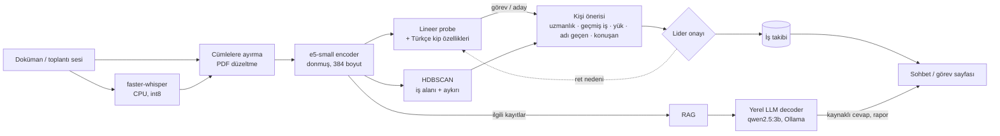

# Görevlendirme Asistanı

**Kurum içinde (on-prem) çalışan, dokümandan ve toplantıdan görev çıkaran, kişi öneren ve liderin onayıyla dağıtan asistan.**

## Problem

Kurumlar toplantı notlarını, şartnameleri ve e-postaları ChatGPT gibi kapalı modellere API ile gönderemiyor: veri kurum dışına çıkar. Sonuç olarak "kim neyi yapacak" işi hâlâ elle yapılıyor, toplantıda söylenen işler kayboluyor, personel "bana ne verildi?" sorusunu e-posta arşivinde arıyor.

## Ne yapıyor

| Kim | Ne |
|---|---|
| **Takım lideri** | Doküman yükler ya da toplantıyı portalda yapar → sistem görev cümlelerini bulur, her biri için kişi önerir ve **nedenini** gösterir → lider onaylar, değiştirir ya da reddeder. |
| **Personel** | Sohbetten "bugün bana ne verildi?", "benimle ne paylaşıldı?" diye sorar; görevini dokümandaki cümlesiyle birlikte görür. |
| **Toplantı** | Herkes kendi mikrofonunu kaydeder (konuşmacı kesin) → CPU'da Türkçe döküm → rapor → "ben bakarım" diyen kişiye görev önerisi. |

Hiçbir aşamada dış API yok: modeller, veritabanı ve arayüz kurumun sunucusunda, **GPU'suz** çalışır.

## Mimari



**Tasarım ilkeleri**
- **Anlama encoder'da, üretme decoder'da.** Görev tespiti ve kişi önerisi hızlı, ölçülebilir ve açıklanabilir bir encoder + sınıflandırıcıda. Decoder yalnızca seçilmiş kayıtlara bakarak cevap ve rapor yazar; dayanağı zayıf satırlar işaretlenir.
- **Öneri + onay, otomatik atama yok.** Düşük güvende lider önce kendi seçimini yapar (bilişsel zorlama); her karar modeli besler (aktif öğrenme).
- **Her çıktı kaynağına bağlı.** Görev, rapor satırı ve sohbet cevabı dokümandaki cümleye ya da döküm satırına götürür.

## Sonuçlar

| Ölçüm | Değer | Not |
|---|---|---|
| **Görev tespiti, kör test seti** (2 doküman, 22 görev) | **F1 0.80** · kesinlik 0.67 · duyarlılık 1.00 | Kural tabanlı başlangıç: F1 0.48. Etiketleyen kişi model çıktısını görmeden etiketledi; eğitim/ayar sırasında kullanılmadı. |
| Görev tespiti, zor doğrulama seti | F1 0.79 (eğitimsiz prototip) | Kural tabanlı başlangıç: 0.16 |
| Görev tespiti, çapraz doğrulama (eğitim dokümanları) | F1 0.98 | Eğitimle aynı dağılım; iyimser. Kör testle arasındaki fark dağılım kaymasından. |
| Kişi önerisi, tespit edilen görevlerde | 6/6 | Küçük örnek |
| Yanıt süresi (CPU) | _ölçülecek_ | Her sohbet cevabının altında istem/üretim süresi gösteriliyor |

**Okuma:** Model kör testte hiçbir görevi kaçırmıyor; yanlış alarmların çoğu "Not: / Hatırlatma:" bilgilendirmeleri ve durum cümleleri. Uygulamada bilgilendirmeler ayrıca duyuru olarak ayrılıyor (bu ölçüm modelin ham çıktısıdır). Lider onaylı akışta yanlış alarm tek tıkla reddedilir ve ret, modelin eğitim verisine döner.

## Bilinen sınırlar

- Toplantı dökümünün kalitesi mikrofona ve whisper model boyutuna bağlı; `small` Türkçe teknik konuşmada zayıf, `medium` önerilir.
- 3B'lik decoder boşluk doldurmaya eğilimli; bu yüzden rapor satırları dökümle karşılaştırılıp işaretleniyor, görev listesi decoder'dan değil encoder hattından geliyor.
- Tablolu ve taranmış PDF'ler henüz iyi okunmuyor.
- Eğitim verisi yazılı metin ağırlıklı; konuşma dili için kurum dökümleri etiketlendikçe iyileşir.
- Kimlik doğrulama geliştirme modunda (başlıkla kullanıcı seçimi); kurulumda LDAP/SSO'ya bağlanacak şekilde ayrıldı.

## Demo

```bash
cd backend
python scripts/demo_data.py     # temiz demo verisi (mevcut veritabanı yedeklenir)
uvicorn app.main:app --port 8000
```
Canlı demoda yapıştırılacak not: `samples/demo/canli_demo_notu.txt`. Demo verisindeki lider kararları kurgusaldır; panodaki "öneri isabeti" model başarısı olarak sunulmamalıdır.

## Ekranlar

| Ekran | Yol | Kimin için |
|---|---|---|
| Ana ekran / sohbet | `/`, `/c/:id` | Herkes |
| Görev sayfası (kaynak cümlesiyle) | `/gorev/:id` | Görevin sahibi, lider |
| Toplantılar, toplantı odası ve rapor | `/toplantilar`, `/toplanti/:id` | Katılımcılar |
| Ekip panosu | `/pano` | Takım lideri |
| Doküman yükle, görevleri incele ve onayla | `/yukle`, `/dokuman/:id` | Takım lideri |
| Dokümanlar | `/dokumanlar` | Takım lideri |
| Ekip üyeleri ve yük | `/ekip` | Takım lideri |
| Veri etiketleme | `/etiketle` | Model geliştirme |

Geliştirme aşamasında kullanıcı, kenar menünün altındaki listeden değiştirilir (`Ayşe Kaya` personel, `Burak Şen` takım lideri). Tüm demo kişi ve görevleri kurgusaldır.

## Arayüz kararları (araştırma dayanağı)

- **Öneri + onay, otomatik atama yok:** Amershi vd., *Guidelines for Human-AI Interaction* (CHI 2019).
- **Düşük güvenli görevlerde lider önce kendi seçimini yapar** (bilişsel zorlama): Buçinca vd., *To Trust or to Think* (CSCW 2021). Aşırı güveni azaltır; sadece düşük güvenli görevlere uygulanır ki akış yavaşlamasın.
- **Güven 3 kademeli sözel etiketle gösterilir**, yüzdeyle değil.
- **Her görev dokümandaki cümlesine bağlı** (kaynak gösterimi); "Kaynak §n" ile vurgulanır.
- **Model isabeti paneli**: liderin güvenini kalibre etmesi için geçmiş öneri isabeti gösterilir.

## Hızlı başlangıç

### Docker (kurum sunucusu)

```bash
cp .env.example .env      # kurum adı, renk, logo
docker compose up -d --build
# http://localhost:8000
```

### Geliştirme

```bash
# Backend
cd backend
python -m venv .venv && source .venv/bin/activate   # Windows: .venv\Scripts\activate
pip install -r requirements.txt
uvicorn app.main:app --reload --port 8000

# Frontend (ayrı terminal)
cd frontend
npm install
npm run dev               # http://localhost:5173  (/api istekleri 8000'e yönlenir)
```

Testler: `cd backend && pytest`

## Encoder modu (eğitimsiz, CPU)

Önceden eğitilmiş, **dondurulmuş** bir cümle-embedding modeli kullanılır; model eğitilmez.

1. **Görev tespiti:** her cümle, örnek görev / görev olmayan cümlelere (`app/ml/prototypes.py`) benzerlik farkıyla puanlanır → `detect_score` (0–1).
2. **Alan etiketi:** etiket açıklamalarına benzerlik (backend, mobil, güvenlik…).
3. **Kişi önerisi:** uzmanlık + geçmiş iş + **en benzer geçmiş işe anlamsal benzerlik** + yük.
4. **İş alanları:** yeni görevler ekibin geçmiş işleriyle birlikte **HDBSCAN** ile kümelenir, kümeler c-TF-IDF ile adlandırılır.
5. **Aykırılar:** hiçbir kümeye girmeyen görev "alışılmadık" sayılır, güveni bir kademe düşer → lider önce kendi seçimini yapar. Az veride HDBSCAN yalnız noktaları kümeye çekebildiği için en-yakın-komşu benzerliğine dayalı robust z-skorla tamamlanır.

```powershell
cd backend
pip install -r requirements-ml.txt        # sentence-transformers (ilk çalıştırmada model iner)
python scripts/evaluate.py --verbose      # mock ile encoder'ı karşılaştır
# .env: GA_LLM_PROVIDER=encoder
```

Model seçimi: `GA_EMBED_MODEL` ile değişir. `gte-small` gibi modeller ağırlıklı İngilizce eğitildiği için Türkçede çok dilli modellerle (ör. `intfloat/multilingual-e5-small`, `-base`) karşılaştırılmalı; `scripts/evaluate.py` bunun için. Değerlendirme seti şu an küçük ve örnek dokümanlardan oluşuyor; gerçek dokümanlar ve etiketler eklendikçe anlamlılaşır.

## Decoder (sohbet, isteğe bağlı)

Görev tespiti ve kişi önerisi encoder'da kalır. Decoder yalnızca sohbette çalışır:
"görevimi açıkla" ve kayıtlara dayanan serbest sorular.

```
soru ─► e5 (encoder): kullanıcının görevleri + paylaşılan doküman cümleleri arasından en ilgili kayıtlar
     ─► istem: [K1] … [K6] kayıtları + "yalnızca bunları kullan, kaynak göster" kuralı
     ─► yerel LLM (decoder, Ollama, CPU 4-bit): nedensel maskeli öz-dikkat → LM head → logit → softmax
     ─► cevap + kaynak etiketleri + ortalama token olasılığı
```

Kurulum: [Ollama](https://ollama.com) yükleyin, `ollama pull qwen2.5:3b`, `.env` içinde `GA_DECODER=ollama`.
Ollama kapalıysa uygulama şablon cevaplarla çalışmaya devam eder.

## Toplantılar (ses → döküm → rapor → görev)

```
Jitsi görüşmesi (kurum içi)        her katılımcının tarayıcısı kendi mikrofonunu kaydeder (10 sn parçalar)
        │                          → konuşmacı ayrımı modeli gerekmez, "kim konuştu" kesin
        ▼
faster-whisper (CPU, int8, tr)     her kayıt ayrı yazıya dökülür, toplantı zamanına göre birleşir
        ▼
döküm dokümanı                     "Ayşe Kaya: Fatura zaman aşımını ben yarın düzeltirim."
        ▼
görev çıkarma hattı                encoder + probe + kümeleme + kişi önerisi
                                   konuşan kişi işi üstlendiyse ("ben bakarım") ona önerilir
        ▼
rapor                              özet/kararlar decoder'dan (varsa), görev listesi her zaman hattan
```

Kurulum: `pip install -r requirements-asr.txt` (whisper modeli ilk kullanımda iner, small ≈ 470 MB).
Görüntülü görüşme için kurum içine [docker-jitsi-meet](https://github.com/jitsi/docker-jitsi-meet)
kurulur ve `GA_JITSI_DOMAIN` verilir. Ses dosyaları yazıya döküldükten sonra silinir (`GA_KEEP_AUDIO=false`);
her katılımcı kayıttan önce açık rıza verir.

## Modeli iyileştirme

Veri toplama, etiketleme ve aktif öğrenme döngüsü: [`docs/VERI_TOPLAMA.md`](docs/VERI_TOPLAMA.md)

- **Veri etiketleme ekranı** (`/etiketle`, lider): doküman yükle → KVKK anonimleştirme → her cümleyi
  görev / değil / belirsiz işaretle → eğitim ya da (kör) test verisine kaydet.
- **"Model emin olamadı" paneli:** eşiğin biraz altındaki cümleler lidere sorulur.
- **Ret nedeni:** "görev değil" eğitim etiketi olur; "görev ama şimdi değil" olmaz.
- `scripts/train_probe.py` dosyadaki etiketleri ve uygulamadaki kararları birlikte kullanır;
  test dokümanlarına ait her şeyi otomatik dışarıda bırakır.

## Mimari

```
frontend/  React + TypeScript + Vite
backend/
  app/
    llm/            sağlayıcı arayüzü (base.py), mock, encoder
    ml/             embedding, prototipler, HDBSCAN kümeleme
    services/
      extraction.py   doküman → görev
      assignment.py   açıklanabilir kişi önerisi (uzmanlık, geçmiş iş, yük)
      assistant.py    sohbet: görev/doküman soruları veritabanından, kaynaklı
      load.py         ekip yükü
      documents.py    PDF/DOCX/TXT metin çıkarma (yerel)
    routers/        REST uçları
    deps.py         kimlik (şimdilik X-User-Id; kurumda LDAP/SSO)
  tests/
```

### LLM sağlayıcısı eklemek

1. `backend/app/llm/` altında `LLMProvider` arayüzünü (`extract_tasks`, `chat`) uygulayan bir sınıf yazın.
2. `backend/app/llm/__init__.py` içindeki `get_provider()` fonksiyonuna dal ekleyin.
3. `.env` içinde `GA_LLM_PROVIDER=<ad>` yapın.

Kişi önerisi bilinçli olarak LLM'den ayrı tutuldu: lider her önerinin gerekçesini görebilsin ve ağırlıklar kurum verisiyle ayarlanabilsin.

## Yol haritası

- [ ] LLM mimarisi ve yerel model sağlayıcısı
- [ ] Kurum kimlik doğrulaması (LDAP / Active Directory / OIDC)
- [ ] Jira / Azure DevOps entegrasyonu (şu an aktarma uygulama içinde)
- [ ] Rol bazlı yetki ve doküman erişim kuralları
- [ ] Önerinin yük bilgisini karar anında yeniden hesaplama
- [ ] PostgreSQL ve Alembic göçleri
